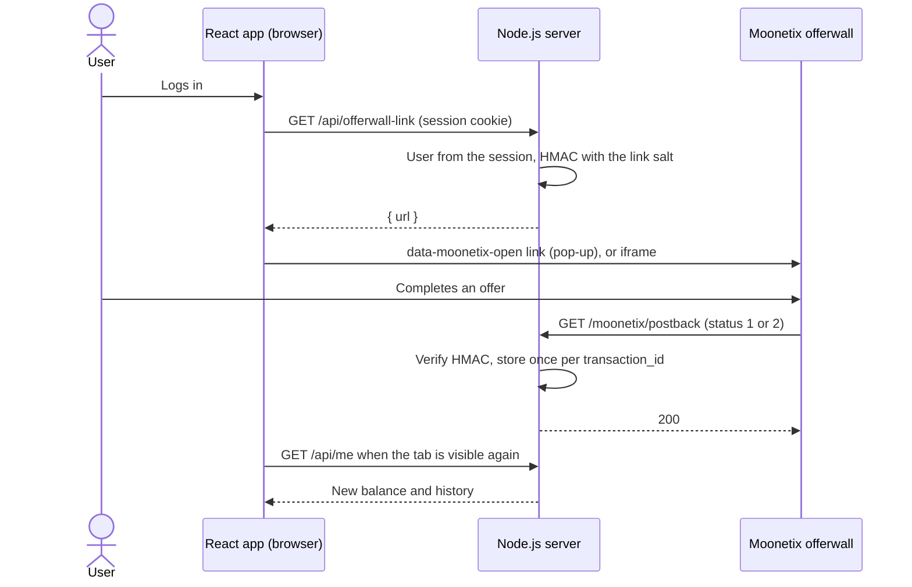

# Moonetix offerwall in React and Vite

**A React and Vite app with a small Node.js backend: accounts, a signed offerwall link, a verified postback endpoint and a live balance. The browser never sees a Moonetix secret.**

[](https://github.com/moonetix/offerwall-react-vite/actions/workflows/ci.yml)
[](LICENSE)
[](https://docs.moonetix.com/offerwall-link)
[](https://moonetix.com/academy/integrations/nextjs-react-offerwall)
[](https://moonetix.com/register?from=github-offerwall-react-vite)
[](https://moonetix.com)

[Moonetix](https://moonetix.com) is an affiliate network: your users earn your own currency by completing offers, and you earn per completed offer. A Vite app is static files, so something has to hold the link hash salt and the postback key. Here that is `server/`, about 500 lines on `node:http` and `node:sqlite`, with no npm packages.

> **Get your App ID and keys: sign up free at https://moonetix.com/register?from=github-offerwall-react-vite**

## What is in the box

1. **A clean split.** `src/` is React 19 and talks to `/api` only. `server/` signs links for the session user and verifies postbacks. `npm run check:bundle` fails the build if the salt or key shows up anywhere in `dist/`.
2. **Postbacks that cannot pay twice.** `transaction_id` is the primary key, credit and balance change run in one `BEGIN IMMEDIATE` transaction, and a reversal takes back what was stored. The tests fire 20 copies of one postback at once and see one credit.
3. **Production details done.** Hashed session tokens in HttpOnly SameSite cookies, scrypt passwords, rate-limited sign-up and login, JSON-only writes with an Origin check, and a Content Security Policy that allows only `wall.moonetix.com`.

## How it fits together



## Quick start

Node.js 22.13 or later.

```bash
git clone https://github.com/moonetix/offerwall-react-vite.git
cd offerwall-react-vite
npm ci
cp .env.example .env      # App ID, link hash salt, postback secret key
npm run dev               # API on :8787, Vite on :5173 with /api proxied
```

Production:

```bash
npm run build && npm run check:bundle
COOKIE_SECURE=true npm start   # serves dist/ and the API on PORT, behind your https proxy
```

Save this postback URL on the Postback page of your Moonetix dashboard:

```text
https://YOUR_DOMAIN/moonetix/postback?tx={transaction_id}&user={user_id}&reward={reward}&status={status}&offer={offer_name}&hash={hash}
```

| Variable | Required | Default | What it is |
| --- | --- | --- | --- |
| `MOONETIX_APP_ID` | yes | none | App ID, under Offerwalls, your offerwall, Integration. |
| `MOONETIX_LINK_SALT` | yes | none | Link hash salt, same place. Server only. |
| `MOONETIX_POSTBACK_KEY` | yes | none | Postback secret key, from the Postback page. Server only. |
| `MOONETIX_CREDIT_TEST_POSTBACKS` | no | `false` | `true` credits dashboard test postbacks (`test_` transaction IDs). |
| `COOKIE_SECURE` | no | `true` | `false` only for plain http on your machine. `.env.example` sets `false`. |
| `PORT` | no | `8787` | API port, and the app port for `npm start`. |
| `HOST` | no | `127.0.0.1` | Listen address. Use `0.0.0.0` in a container. |
| `DATABASE_PATH` | no | `./data.sqlite` | SQLite file. |

The server reads `.env` from the repo root if it exists, otherwise the real environment. A missing key is logged as `MOONETIX_APP_ID is not set. See .env.example.` at start.

Never give these a `VITE_` prefix: Vite inlines `VITE_` variables into the JavaScript it ships.

## How it works

1. Sign-up asks for an email, a password of 10 or more characters and confirmation that the user is 16 or older. Emails are unique regardless of case.
2. The session cookie holds a random token. The database stores only its SHA-256, so a leaked database does not leak sessions.
3. `GET /api/offerwall-link` reads the user from the cookie, never from the query, and returns the link with `Cache-Control: private, no-store`. The `useOfferwallLink` hook drops a link fetched for a previous user.
4. The Earn button is a normal link with `data-moonetix-open`. When `embed.js` has loaded, it opens the offerwall in a pop-up over the page; otherwise the link opens the offerwall itself. "Show offers on this page" swaps in an iframe instead.
5. `GET /moonetix/postback` accepts each signed parameter exactly once and checks the HMAC-SHA256 of `tx:user:reward:status` in constant time (403 if wrong). Signed but unusable values get 400. `test_` postbacks are logged and answered 200.
6. In one transaction: status 1 inserts the transaction and adds the reward once; status 2 subtracts the stored amount from the stored user once; a reversal of an unknown transaction is stored with amount 0 so a late credit cannot pay. The answer is 200 only after the commit, 500 on errors so Moonetix retries.
7. The React app reloads `/api/me` when the tab becomes visible again, which is when users come back from the offerwall.

The iframe and pop-up only load on https pages of the website you registered for the app. On `http://localhost` they stay blank, which is expected: open the link in a new tab while you develop.

## Security notes

- Secrets are read from the environment by `server/` only. `src/` never imports from `server/`.
- The hash is the first check on a postback, with `crypto.timingSafeEqual` behind a length check.
- Only `{reward}` is signed. `{offer_name}` is shown in the history but never decides an amount.
- Writes must be `application/json` and same-origin, which a cross-site form cannot send. Sessions are `HttpOnly; SameSite=Lax`, and `Secure` in production.
- Balances are integers in millionths of a coin. A reversal can take a balance below zero; say so in your terms.
- Reward only completed offers, never joins, invites, likes or reviews. Users must be 16 or older.
- The rate limiter is in memory, which suits one process. Behind several instances, move it to your proxy or Redis.

## Test it

```bash
npm test
```

No network and no packages needed. The tests start the real server on a random port with an in-memory database and check sign-up rules, rate limits, CSRF defenses, logout, that the signed link equals the Moonetix link for the session user, credits, retries, decimals, 20 parallel copies, reversals, a reversal before its credit, unknown users, `test_` postbacks, tampered and wrongly signed postbacks, repeated parameters, the CSP header and path traversal.

By hand:

```bash
TX=local_1 U=1 R=150 S=1
HASH=$(printf '%s' "$TX:$U:$R:$S" | openssl dgst -sha256 -hmac "$MOONETIX_POSTBACK_KEY" | sed 's/^.* //')
curl -i "http://127.0.0.1:8787/moonetix/postback?tx=$TX&user=$U&reward=$R&status=$S&hash=$HASH"
```

For the whole set of edge cases, run [postback-tester](https://github.com/moonetix/postback-tester) against `npm run dev`. It signs postbacks exactly like Moonetix and sends a credit and its retry, three kinds of reversal, four forged or unsigned requests and five parallel copies of one credit. Its transaction IDs start with `test_`, so set `MOONETIX_CREDIT_TEST_POSTBACKS=true` in `.env` while it runs, sign up once so user `1` exists, and keep `MOONETIX_POSTBACK_KEY` set in your shell as for the curl above:

```bash
npx github:moonetix/postback-tester --preset moonetix \
  'http://127.0.0.1:8787/moonetix/postback?tx={transaction_id}&user={user_id}&reward={reward}&status={status}&offer={offer_name}&hash={hash}' --user 1
```

With Moonetix, once the server is reachable over https:

1. Offerwalls, your offerwall, Integration: under Integration status, **Check a link** and **Test a link** for user ID `1` must match the link the app shows.
2. Click **Send a test postback**, or use the Postback page. The server logs the test and answers 200. Every attempt is listed under Reports, Postbacks.
3. Open the offerwall from a normal home or mobile connection. VPNs, proxies and data center networks see a block page.

## Troubleshooting

| What you see | Why, and the fix |
| --- | --- |
| Earn shows `Offerwall not configured.` (500 from `/api/offerwall-link`) | `MOONETIX_APP_ID` or `MOONETIX_LINK_SALT` is missing. Check the warning printed at start. |
| Sign-in works, then every call says `Not signed in.` | `COOKIE_SECURE` is `true` on plain http, so the browser drops the cookie. Serve over https, or set `COOKIE_SECURE=false` locally. |
| `Bad request.` on sign-up or login from your own client | Writes must be `Content-Type: application/json` and same-origin. |
| `Too many attempts. Try again later.` | The in-memory rate limit on sign-up and login. It resets with time or a restart. |
| `npm start` shows `Run npm run build first.` | `dist/` is missing. Run `npm run build`. |
| Postback answers `403` | Wrong `MOONETIX_POSTBACK_KEY`, a changed value, or a signed parameter sent twice. `400` means signed but unusable values (bad status or reward). |

## Learn more

- Academy: [How to add an offerwall to a Next.js or React app](https://moonetix.com/academy/integrations/nextjs-react-offerwall)
- Academy: [Add a floating Earn button to any website](https://moonetix.com/academy/integrations/floating-earn-button)
- Docs: [Offerwall link](https://docs.moonetix.com/offerwall-link), [Postbacks](https://docs.moonetix.com/postbacks), [Credits and reversals](https://docs.moonetix.com/credits-and-reversals), [Testing](https://docs.moonetix.com/testing)
- Moonetix for [web apps](https://moonetix.com/industries/web-apps) and [websites](https://moonetix.com/integrations/website)
- Tools: [offerwall link builder](https://moonetix.com/tools/offerwall-link-builder), [postback hash checker](https://moonetix.com/tools/postback-hash-checker)

## Start earning

**Get your App ID and keys: sign up free at https://moonetix.com/register?from=github-offerwall-react-vite**

Every publisher application is reviewed by hand. Once you are approved, add your site, set your currency, and paste the keys into `.env`.


## More Moonetix examples

| Repository | What it covers |
| --- | --- |
| [awesome-offerwalls](https://github.com/moonetix/awesome-offerwalls) | Curated list of offerwall networks, tools and guides |
| [offerwall-postback-handlers](https://github.com/moonetix/offerwall-postback-handlers) | Postback handlers in PHP, Node.js, Python and Java |
| [offerwall-nextjs-starter](https://github.com/moonetix/offerwall-nextjs-starter) | Next.js App Router starter |
| [telegram-mini-app-offerwall](https://github.com/moonetix/telegram-mini-app-offerwall) | Telegram Mini App with server-side `initData` checks |
| [discord-rewards-bot](https://github.com/moonetix/discord-rewards-bot) | Discord bot with an economy and offerwall rewards |
| [moonetix-offerwall-wordpress](https://github.com/moonetix/moonetix-offerwall-wordpress) | WordPress plugin |
| [offerwall-laravel](https://github.com/moonetix/offerwall-laravel) | Laravel integration |
| [offerwall-django](https://github.com/moonetix/offerwall-django) | Django integration |
| [offerwall-express](https://github.com/moonetix/offerwall-express) | Express integration |
| [offerwall-vue-nuxt](https://github.com/moonetix/offerwall-vue-nuxt) | Vue and Nuxt integration |
| [rewards-site-starter](https://github.com/moonetix/rewards-site-starter) | Rewards (GPT) site starter in PHP and SQLite |
| [offerwall-godot](https://github.com/moonetix/offerwall-godot) | Godot integration |
| [offerwall-flutter-example](https://github.com/moonetix/offerwall-flutter-example) | Flutter sample app |
| [postback-tester](https://github.com/moonetix/postback-tester) | Sends signed test postbacks and catches double credits, missed reversals and forged requests |
| [signup-guard](https://github.com/moonetix/signup-guard) | Sign-up risk checks for Node.js and PHP: disposable emails, datacenter and Tor IPs |
| [datacenter-ip-ranges](https://github.com/moonetix/datacenter-ip-ranges) | Daily cloud, Tor and iCloud Private Relay IP ranges from official feeds |
| [offerwall-fraud-playbook](https://github.com/moonetix/offerwall-fraud-playbook) | Fraud playbook for offerwall and rewards publishers, with tested code |
| [reward-economy-kit](https://github.com/moonetix/reward-economy-kit) | Integer points math: payout to points, bonuses, reversals, cash-out pricing |
| [referral-engine](https://github.com/moonetix/referral-engine) | Referral codes, attribution and a clawback-safe commission ledger |
| [gamification-kit](https://github.com/moonetix/gamification-kit) | Streaks, XP levels, quests and leaderboards that survive time zones and DST |
| [affiliate-postback-macros](https://github.com/moonetix/affiliate-postback-macros) | Postback macros and signatures of tracking platforms and offerwalls |
| [country-tiers](https://github.com/moonetix/country-tiers) | Tier 1, 2 and 3 countries as JSON and CSV, with helpers in JavaScript, PHP and Python |

## License

MIT. See [LICENSE](LICENSE).
